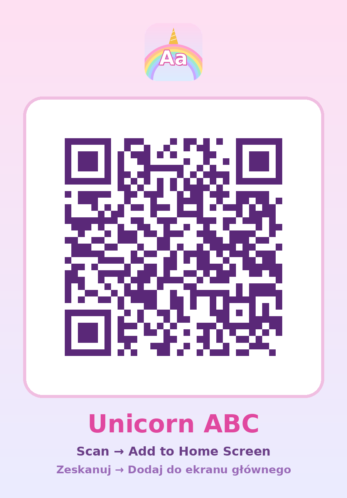

# 🦄 Unicorn ABC

Learn to read with letter **sounds** (phonics) – English first, Polish as an extra language.

- 🌸 Letters – hear each sound, see a picture, trace the letter
- 🚂 Read – blend sounds on a train, read the word out loud into the microphone, grow a flower
- 🎈 Balloons – pop the balloon with the sound you hear
- 🌷 My garden – every word read correctly blooms a new flower

Install: open https://zondelekpp-wq.github.io/UnicornABC/ and choose **Add to Home Screen**.

